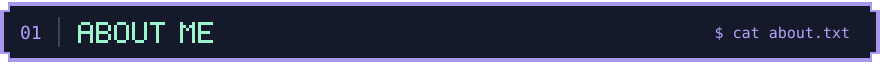
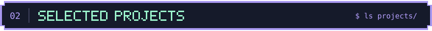

  <a href="https://portfolio.mathis-db.com/en/"><strong>Explore my portfolio ↗</strong></a>

<h2></h2>

Hi, I'm **Mathis Dubuisson**, a **Product & Software Engineer at Galadrim**, based in Paris.

I mostly code for fun outside work. I make games and web apps, explore AI, and experiment with 3D rendering. I'm an engineering graduate from **ENSICAEN**.

  <a href="https://portfolio.mathis-db.com/en/about/">More about me</a> ·
  <a href="https://www.linkedin.com/in/mathis-dubuisson">LinkedIn</a> ·
  <a href="https://portfolio.mathis-db.com/en/contact/">Get in touch</a>

<h2></h2>

<table>
  <tr>
    <td width="50%" valign="top">
      <h3> <a href="https://github.com/Westerbay/Booster-Break">Booster Break</a></h3>
      
A Pokémon card collection app with pack opening, trading, and simultaneous three-card multiplayer duels.

      
<code>TypeScript</code> <code>React</code> <code>Elysia</code>

      
<a href="https://github.com/Westerbay/Booster-Break">Source code</a> · <a href="https://portfolio.mathis-db.com/en/projects/booster-break/">Project story ↗</a>

    </td>
    <td width="50%" valign="top">
      <h3> <a href="https://github.com/Westerbay/SpellWar">SpellWar</a></h3>
      
A third-person 3D game with a custom C++ engine, shifting gravity, PBR rendering, physics, and terrain generation.

      
<code>C++17</code> <code>OpenGL</code> <code>GLSL</code>

      
<a href="https://github.com/Westerbay/SpellWar">Source code</a> · <a href="https://portfolio.mathis-db.com/en/projects/spellwar/">Project story ↗</a>

    </td>
  </tr>
  <tr>
    <td width="50%" valign="top">
      <h3> <a href="https://github.com/Westerbay/The-Algorithmic-Beauty-of-Plants">The Algorithmic Beauty of Plants</a></h3>
      
An interactive L-system editor and custom 3D plant renderer, available as a reusable React component.

      
<code>TypeScript</code> <code>React</code> <code>WebGL</code>

      
<a href="https://github.com/Westerbay/The-Algorithmic-Beauty-of-Plants">Source code</a> · <a href="https://westerbay.github.io/The-Algorithmic-Beauty-of-Plants/">Live demo ↗</a>

    </td>
    <td width="50%" valign="top">
      <h3> <a href="https://github.com/Westerbay/StyleGan-and-Cheap-DiT">StyleGAN &amp; Cheap DiT</a></h3>
      
Compact image-generation experiments with a StyleGAN-inspired generator and a latent diffusion transformer.

      
<code>Python</code> <code>PyTorch</code> <code>Docker</code>

      
<a href="https://github.com/Westerbay/StyleGan-and-Cheap-DiT">Source code</a> · <a href="https://portfolio.mathis-db.com/en/projects/stylegan-cheap-dit/">Project story ↗</a>

    </td>
  </tr>
  <tr>
    <td width="50%" valign="top">
      <h3> <a href="https://github.com/Westerbay/Cloudflare-RAG">Cloudflare RAG</a></h3>
      
A RAG API that answers questions from Markdown knowledge bases and cites its sources.

      
<code>TypeScript</code> <code>Workers AI</code> <code>Vectorize</code>

      
<a href="https://github.com/Westerbay/Cloudflare-RAG">Source code ↗</a>

    </td>
    <td width="50%" valign="top">
      <h3> <a href="https://github.com/Westerbay/WebApp-Template">WebApp Template</a></h3>
      
A reusable full-stack TypeScript template with authentication, typed APIs, and built-in observability.

      
<code>TanStack Start</code> <code>NestJS</code> <code>PostgreSQL</code>

      
<a href="https://github.com/Westerbay/WebApp-Template">Source code ↗</a>

    </td>
  </tr>
</table>

  <samp><a href="https://github.com/Westerbay?tab=repositories">All repositories</a> · <a href="https://portfolio.mathis-db.com/en/projects/">More projects on my portfolio</a></samp>

<!--
Pixel-art terminal personalized for Mathis, inspired by Typewriter Intro:
https://github.com/beydemirfurkan/awesome-github-profile/tree/main/templates/02-animated/typewriter-intro
The MIT license and original copyright notice are preserved in LICENSE and the terminal SVG.
Section labels and project icons are original pixel-art SVGs included under the same MIT license.
-->
